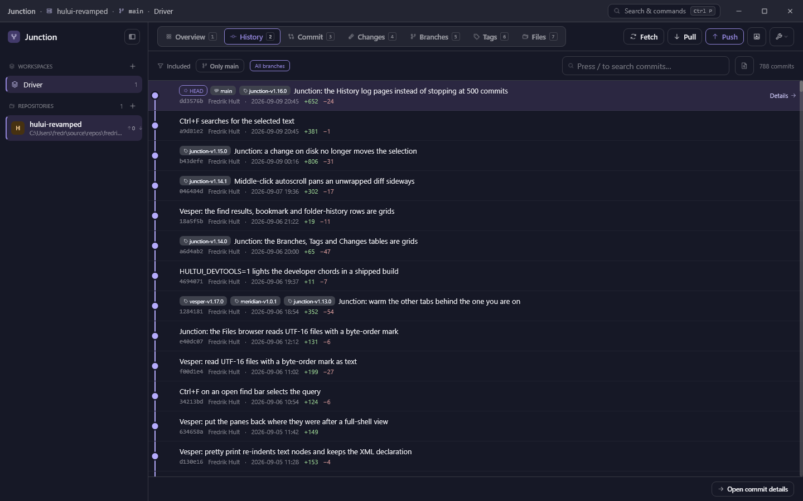

# Junction — Design Handover (state of the app, September 2026)

**For:** Claude Design
**From:** implementation
**Date:** 2026-09-12
**Scope:** Where Junction stands today versus the July 2026 design handoff, so the next design round (the GitLab integration, see `GITLAB-DESIGN-BRIEF.md`) starts from the real app rather than the prototype.

---

## 0. What this is

The July handoff (`gitclient-design/design_handoff_junction_git_client`, 2026-07-12) specified a five-view Fork-style client in the Nocturne idiom. Everything in it was built, then two months of daily use added views, panels, and behaviours the prototype never had. This document is the delta. Read it with the screenshots in `design/shots/` open — every screenshot is the app's own pixels, rendered headless at 1440×900, not a mock.

**What has not changed:** the Nocturne token set and its roles, the sidebar/toolbar/view skeleton, the branch-name parsing into `FEAT / REL / WIP / MAIN` chips, the palette, context menus as the primary action surface, the toast idiom, and the rule that the active repo and branch appear only in the title bar.

**What Design must know before drawing anything new:**

1. **There are seven views, not five.** Tags (6) and Files (7) joined the segmented control. The toolbar is at its width limit: the compact breakpoint had to move from 910 to 1140 dip of content width to fit them. **Do not add an eighth tab.** New surfaces are overlay panels or live inside an existing view.
2. **Eleven colour schemes share every screen.** Nocturne is still the house style and the default, but the same layout renders in Gruvbox, Solarized Light, Rosé Pine and eight more. Design in Nocturne, name colours by role (accent ramp, neutral ramp, `On(x)` text steps, diff add/del), never by hex. A light scheme inverts the ramp.
3. **Icons are real Phosphor artwork now.** The July build used Unicode stand-ins; the framework rasterises Phosphor's SVG paths, so any `ph-<name>` glyph is available at any size.
4. **There is no Options dialog.** It was planned (`OPTIONS_DIALOG_PLAN.md`) and never built. Settings are toggled from the palette, the composer, and one Appearance card. Anything that needs configuration today lands either in the palette or in a dedicated overlay panel.
5. **Nothing in Junction talks HTTP.** Every remote operation is a `git` subprocess. The only "hosting" feature is `.issuetracker` link rules (Fork's convention) that turn `PC-1042` into a clickable URL. A GitLab integration is the first network client in the app.

---

## 1. Chrome

### Title bar (40px)

Breadcrumb `Junction · <repo> · <branch> · <workspace>` at the left, draggable. Right: a **Search & commands** button with a `Ctrl P` key chip (this opens the palette; `Ctrl K` still works as a legacy alias), then the three **Windows caption buttons** (minimise, maximise, close) — the prototype's macOS traffic lights on the left are gone. The window is custom-chrome with Snap Layouts on the maximise button. Below 1140 dip of content width the breadcrumb drops branch and workspace and the search button collapses to its magnifier.

### Toolbar (52px)

Left: the segmented view tabs, each with icon, label and a monospace shortcut digit `1`–`7`. Changes carries a live dirty-count badge (the accent pill `3` in `04-changes.png`). Compact mode goes icon-only with the label and digit in the tooltip.

Right, unchanged in order but changed in behaviour:

- **Fetch / Pull / Push.** Pull shows the behind count, Push the ahead count. All three **animate in place while running** (fetch spins, pull/push travel down/up and fade) and the label goes present-tense ("Fetching…"). Push on an unpublished branch **publishes** it and the toast says so ("Published X to origin"). Force-push is a checkbox inside a confirm dialog, never a bare button.
- **Stash** icon button opens a two-row popover: *Stash changes* / *Stash including untracked*.
- **Repository tools** caret menu (`08-repository-tools-menu.png`): *Worktrees… · Submodules… · Remotes…* — *Reflog (recover work)…*. These four used to hide in the palette; the menu exists because nobody found them. **This menu is the natural home for the next repository-scoped tool.**

Minimum window 760×540 dip. Below 620 dip of content width the Commit and Changes views hide their diff pane and the file list fills.

### Sidebar (266px expanded, 58px rail)

`10-sidebar-add-popover.png` shows the add popover. Sections:

- **Workspaces** — `+` creates a workspace directly. Rows: icon (16 choices), name, repo count. Right-click: Open · Edit… · Duplicate — Delete.
- **Repositories** — `+` opens the anchored popover *Add existing repository… / Clone repository…*. Rows: a **coloured initial tile** (one of six swatches chosen per repo in Repository settings; the prototype's hash-derived colours are gone), name, parent folder, a dirty dot, `↑n ↓n`. Rows **drag to reorder** — the order is what `Alt+1…9` indexes. Right-click: Open · Repository settings… — Add to / Remove from `<workspace>` — Worktrees… — Show in Explorer · Open in terminal · Copy path — Remove repository.
- **Worktree child rows** under a repo (branch chip + folder, tags `main` / `locked` / `gone`) plus a *New worktree* row when any exist. A worktree is not a repository in the sidebar any more; it is a child of the one it belongs to.
- **Co-usage card** (*Often opened with <repo>*) renders only when there is a suggestion, so a one-repo workspace never shows it.

The collapsed rail keeps the initial tiles, the active one ringed.

### Command palette (`09-command-palette.png`)

Ctrl P. 600×460 card, unchanged shape. Rows carry a kind tag (*Action / View / Repo / Workspace / Branch*). Actions today: Pull · Push · Fetch all remotes · Create new branch… · Worktrees… · Search file contents… · History: only the current branch · Diff: unified or split (s) · Diff: wrap long lines (w) · Diff: fullscreen (F11) · Diff: ignore whitespace changes (i) · Commit: show or hide the message body (m) · Find in this diff or file (f) · Background fetch on/off · Reflog… · Appearance: colour scheme… · Submodules… · Remotes… · Commit staged changes · Stash changes · Stash including untracked · Add existing repository… · Clone repository… · New workspace…; then *Go to <view>* ×7, every repo, every workspace, *Checkout <branch>* for each local branch. **Every new feature must register its verbs here** — the palette is the discoverability floor.

### Global keys

`1`–`7` views · `` ` `` sidebar · `Alt+1…9` / `Alt+↑↓` repo · `Ctrl+1…9` workspace · `Ctrl+P` palette · `/` focuses the active view's search · `f` / `Ctrl+F` find bar · `s w i m F11` diff toggles · `Ctrl+D` diff in VS Code · `Ctrl+O` open file · `Ctrl +/−/0` interface scale · `Esc` closes the topmost overlay.

---

## 2. Views

### 1 · Overview (`01-overview.png`)

As designed: kicker, workspace name, `N repositories · M with uncommitted work`, a three-column card grid (tile · name · path · `N changed` tag · branch chip · `↑ ↓ ⌗version` · *Open →*). **Not built:** the workspace description paragraph (no field on the workspace model). The version stat is the latest reachable tag.

This is the only workspace-wide screen. It is thin today and it is where a multi-repo integration would earn its keep.

### 2 · History (`02-history.png`, `02b-history-only-current-branch.png`)

The include bar changed. Left: `Included` label, an **Only <current branch>** toggle button (lit in `02b`), then either an *All branches* tag or the explicit include chips with *Clear*. Right: a search box (`/`, client-side filter over what is loaded, `*` and `?` wildcards), a **content-search** button that opens a second bar (pickaxe `-S` / regex `-G`, applies on Enter), and the commit count.

Rows: lane graph, ref chips (`HEAD` outline, branch, `tag` neutral), subject, then `sha · author · absolute timestamp · +adds −dels`. The focused row shows *Details →*. **Selection is a Windows list**: click, Ctrl+click toggle, Shift range, Ctrl+Space; two or more selected turns the Commit view into a range compare and the footer button into *Compare N commits*. Right-click inside a selection keeps it.

Footer: paging — *The newest 1,000 commits · Load 1,000 more · Load all* — on the left, *Open commit details* on the right. The log pages on scroll and never stops at 500 any more.

Commit context menu today: Checkout (detached) · Create branch here… · Create tag here… — Cherry-pick onto `<cur>` · Rebase `<cur>` onto this · **Quick rebase ▸** (Squash into parent · Fixup into parent — Drop) · Interactive rebase from here… · Revert — Reset soft / mixed / **hard** — Save as patch… · Copy SHA. Issue references in subjects are underlined accent links when the repo has an `.issuetracker` file.

### 3 · Commit (`03-commit.png`)

Header: *← History* ghost, subject, ▲▼ prev/next. Metadata row: avatar initials, author, `commit <sha>` chip (**click copies the full SHA**), timestamp, branch. The message body is a **collapsible** paragraph (*Hide message* / *N more lines*, key `m`), scrollable when long, selectable, with issue links.

Body: file list as a **folder tree** (`N FILES CHANGED`, folders with change counts, status letters `M A D R U`), a **draggable splitter**, and the diff pane. Diff header: monospace path · **Unified / Split / Wrap** segmented control · ignore-whitespace toggle (`W` icon, key `i`) · *Open in VS Code* (Ctrl D) · fullscreen (F11). Diffs are syntax-highlighted (TextMate grammars) with intra-line word emphasis; binaries get a summary card (sizes, hashes, delta); images get a side-by-side image diff. A find bar (`f`) with match-case / regex / prev / next sits above the diff when open.

### 4 · Changes (`04-changes.png`)

Left column (330px default, draggable) stacks: an optional **sequencer banner** (two rows: *Merge · 2 conflicts left* + Abort / Skip / Continue — also for rebase, cherry-pick and revert; ours/theirs labels flip correctly during a rebase), then sections **Conflicts · n**, **Staged · n** (*Unstage all*), **Changes · n** (*Stage all*), **Hidden · n** (assume-unchanged files with *Watch again*). Sections are folder trees with checkbox tiles per folder and per file. Multi-select mirrors History, confined to one section.

Composer: Summary, Description, **Amend last commit**, **Sign commit (GPG/SSH)**, a full-width primary button whose label says what will happen (*Commit 1 staged file*). Ctrl+Enter commits.

Diff pane is the same as Commit's plus **line and hunk staging**: the strip *Click a line or hunk header to unstage part of this file* and leading checkboxes on `+`/`−` lines; an action bar applies Stage / Unstage / Discard for the ticked lines. Selecting a conflicted file swaps the pane for a **resolution pane**: per-region cards (ours / base / theirs, Ours · Theirs · Both · Edit · Reset), All-ours / All-theirs, *N of M resolved*, *Mark resolved*, and *Open in VS Code*.

File context menu: Stage/Unstage (N) · Stage all/Unstage all — Open file · Open diff in VS Code · Copy path — Add to .gitignore / Ignore all `*.ext` (untracked) or Assume unchanged (tracked) — **Discard changes**.

### 5 · Branches (`05-branches.png`)

Header: title, search (`/`, wildcards), **Tree / List** toggle, **New branch** (primary), **Worktrees** (opens the panel). An optional compare bar appears when two tips are picked (*Comparing A → B · View diff · Clear*).

Grid: **BRANCH · LAST COMMIT · UPDATED · AHEAD / BEHIND · IN HISTORY · ACTIONS**. In tree mode `/`-segmented names group into collapsible folders with counts, remotes group under their name (`origin 5`), and rows keep one height so the list stays virtualised. Branch cell: prefix chip + mono leaf + `current` tag. Remote rows show `—` for ahead/behind and only *Checkout*. Actions: Checkout · push · pull · delete icon buttons.

Branch context menu: Checkout · Create branch from… · Rename… · Create worktree for this branch… — Merge into `<cur>` · Rebase `<cur>` onto — Push · Pull · Set upstream… — Include/Exclude from history · Copy name — **Delete branch**. Delete asks first and can discard unmerged work.

### 6 · Tags (`06-tags.png`) — new

Same header shape as Branches (search, Tree / List, **New tag**). Grid: **TAG · COMMIT · CREATED · KIND · ACTIONS**. Tag cell: `TAG` chip + mono name + the annotation subject as subtitle. Kind is `annotated` or `lightweight`. Actions: Checkout · push · delete. Context menu adds *Push to <remote>*, *Delete on <remote>*, copy name/hash, create branch at tag.

### 7 · Files (`07-files.png`) — new

Browses **a commit's tree, not the working tree**. Header: *Files* · short hash · subject · `N files` · ▲▼ to step commits. Left: a 300px tree with its own filter box (`/`). Right: the file at that revision, syntax-highlighted, with size and line count, a **Blame** toggle (annotates each line with commit/author/date; click a row to jump to that commit in History), and open / reveal buttons that resolve the path against the working tree and grey out when it is not there.

---

## 3. Overlays and dialogs

Stacking order, bottom to top: fullscreen diff → toast → palette (z 40) → the four **repository panels** (z 42) → Appearance → DialogSpec prompt/confirm (z 45) → interactive rebase → popover menus → repo/workspace modal.

**Repository panels** (`11-worktrees-panel.png`) are the established shape for a repository-scoped tool: a 640-wide card, max-height 560, header with icon + title + mono repo name + ✕, a toolbar row of secondary buttons, then rows with a leading tile, a title line with chips/tags, a muted mono subtitle, and per-row actions on the right; right-click for the rest. Esc closes. Four exist: Worktrees (*New worktree · Prune*; rows Open / Remove, lock/unlock), Submodules (*Add submodule · Update all · Sync URLs*; Init & update / Open / Update), Remotes (*Add remote*; rows show fetch URL and a `push ≠ fetch` tag; Edit URL / Remove / Rename), Reflog (rows with a verb chip; *Branch here*, reset variants).

**Repo / workspace modal** (520 wide, five modes: Add local repository · Clone repository · New workspace · Edit workspace · Repository settings): name, icon picker (workspaces), the six colour swatches, live preview, membership checklist. Clone takes a URL and a target folder via the native folder picker.

**DialogSpec** is the single-field prompt and the confirm card: title, body, optional text field with validation, optional checkbox (force-with-lease on push, annotated on tag), primary + Cancel; Enter confirms, Esc cancels. Two-field inputs chain two prompts.

**Interactive rebase** modal (760 wide): newest-first rows with a six-action segmented control, reorder by drag or Alt+↑↓, a live summary, a nested reword sub-dialog.

**Appearance** (`12-appearance.png`): eleven self-painted scheme cards, interface scale chips 80–200%, code font name + size stepper with a preview line. Reached from the palette only.

**Find bar**: field · Aa · .* · prev · next · ✕, docked above the diff, file viewer or blame.

**Toasts**: bottom-centre pill, check icon, one line, ~1.7 s. Failures flash the git stderr in the same pill.

---

## 4. Behaviours the prototype did not have

- **Per-repo caching and a filesystem watcher.** Switching repos is instant when nothing changed; a commit made by another tool shows up without a click. Background auto-fetch exists but is off by default and toggled from the palette.
- **Tab warming.** The other views load behind the one you are on, so a tab switch does not show *Loading…*.
- **Range compare, patch export, multi cherry-pick, quick rebase** from the History selection.
- **Sequencer awareness.** Merge, rebase, cherry-pick and revert conflicts all route to the Changes view with the right banner and the right ours/theirs wording.
- **Publish-on-push, force-with-lease, protected-flow confirmations** for every destructive verb (reset hard, delete branch, discard, force push, remove worktree).
- **Issue links** from `.issuetracker` rules in commit subjects and bodies.
- **Drag to reorder repos**, drag the two splitters, drag rebase rows.
- **Interface scale, code font, eleven schemes.**

---

## 5. Known gaps (do not design around them, but know they are there)

- No Options dialog. Auto-fetch interval, pull strategy, prune, sign-by-default and external tools are settings with no UI beyond the palette toggles and the composer checkbox.
- Overview has no workspace description and no per-repo status beyond the dirty count.
- Repo display names are folder-derived and not editable.
- No Git LFS, no git-flow, no hosting integration (the subject of the GitLab brief).

---

## 6. Screenshot index

| File | Shows |
|---|---|
| `design/shots/01-overview.png` | Overview, one-repo workspace |
| `design/shots/02-history.png` | History on this repository, `All branches`, 788 commits |
| `design/shots/02b-history-only-current-branch.png` | The *Only <branch>* include toggle lit, on a demo repo |
| `design/shots/03-commit.png` | Commit view: collapsible message, folder tree, highlighted unified diff |
| `design/shots/04-changes.png` | Changes with one staged and two unstaged files, line-staging strip |
| `design/shots/05-branches.png` | Branches in tree mode with `claude/` and `origin/` groups |
| `design/shots/06-tags.png` | Tags view |
| `design/shots/07-files.png` | Files view with a JSON file open |
| `design/shots/08-repository-tools-menu.png` | The toolbar's Repository tools menu |
| `design/shots/09-command-palette.png` | Palette, empty query |
| `design/shots/10-sidebar-add-popover.png` | Sidebar `+` popover, demo repo on a `feature/…` branch |
| `design/shots/11-worktrees-panel.png` | A repository panel (the z-42 overlay shape) |
| `design/shots/12-appearance.png` | Appearance card: schemes, scale, code font |

Regenerate any of them with the headless driver (`.claude/skills/run-hultui-app/`); the real window is never screen-grabbed.
