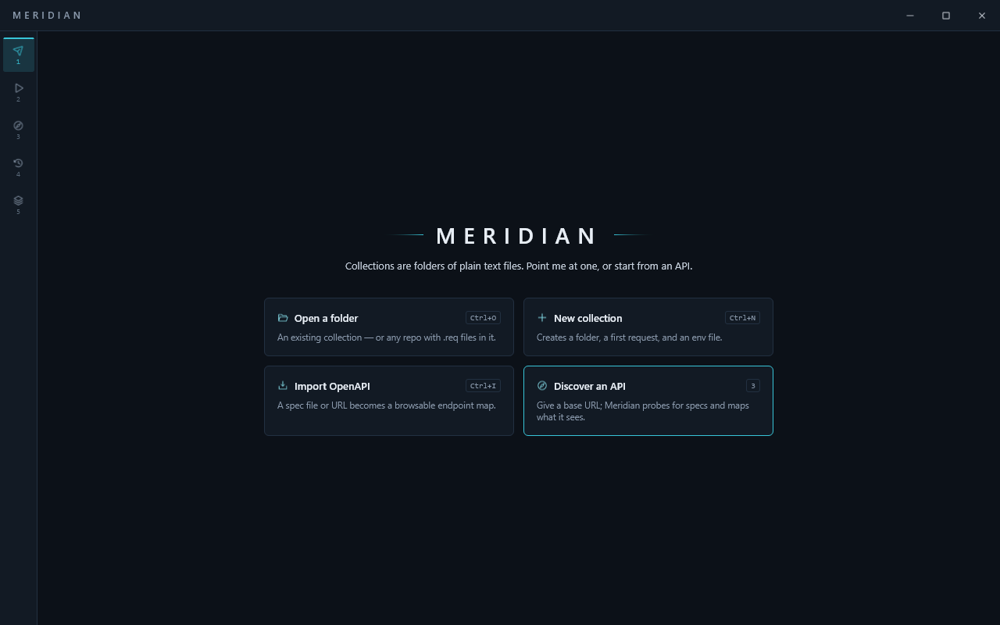
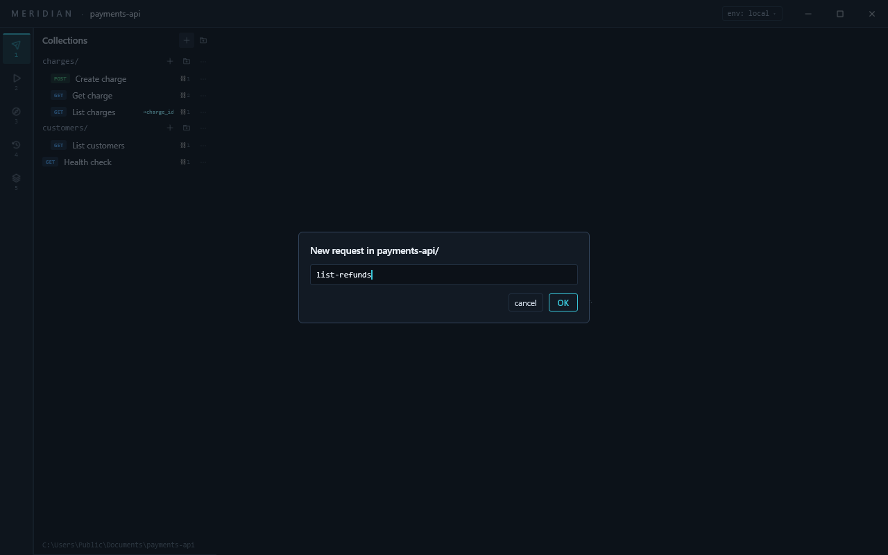
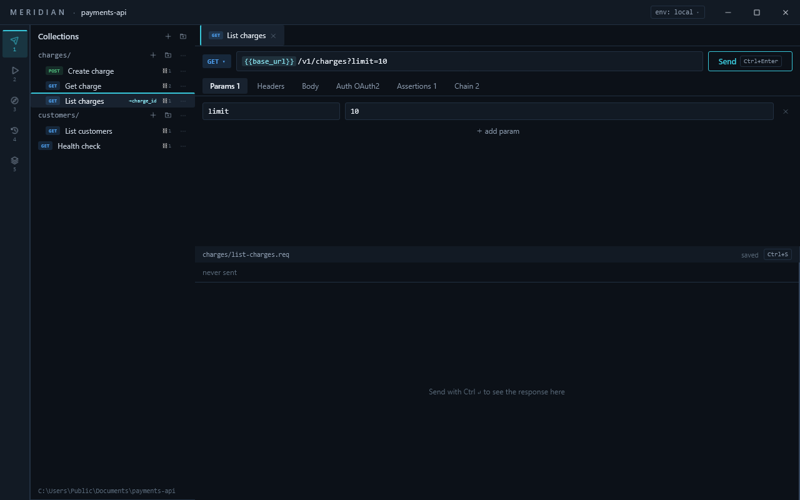
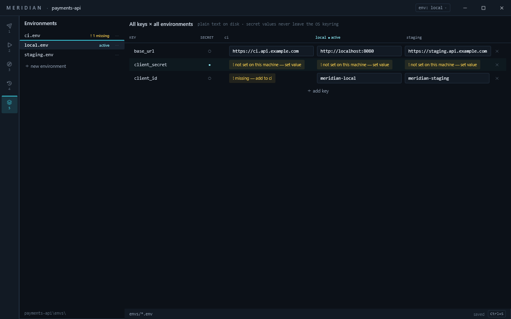
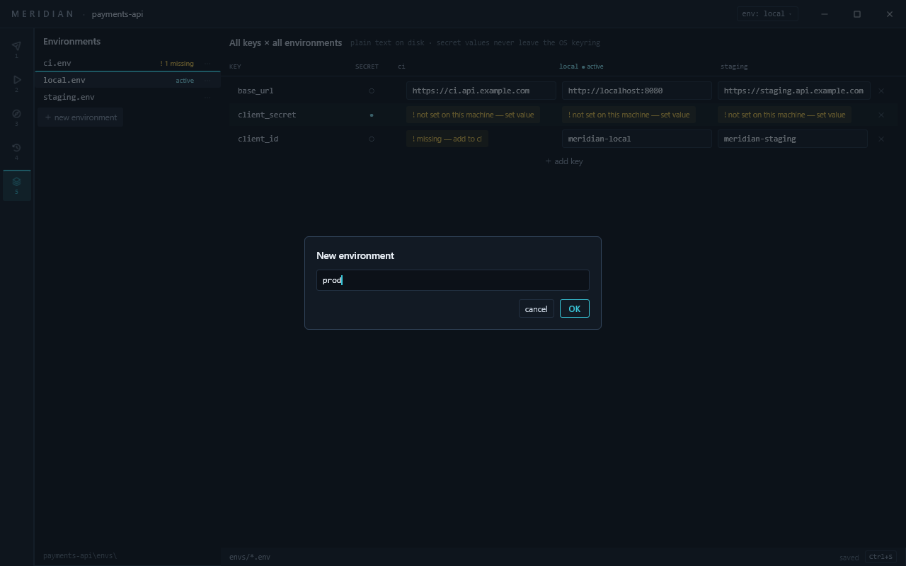
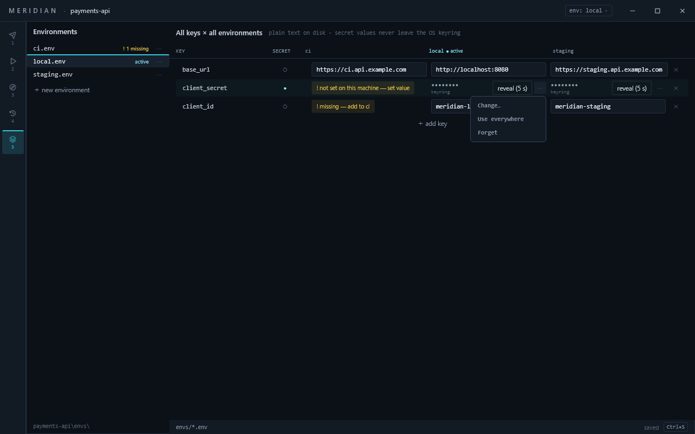
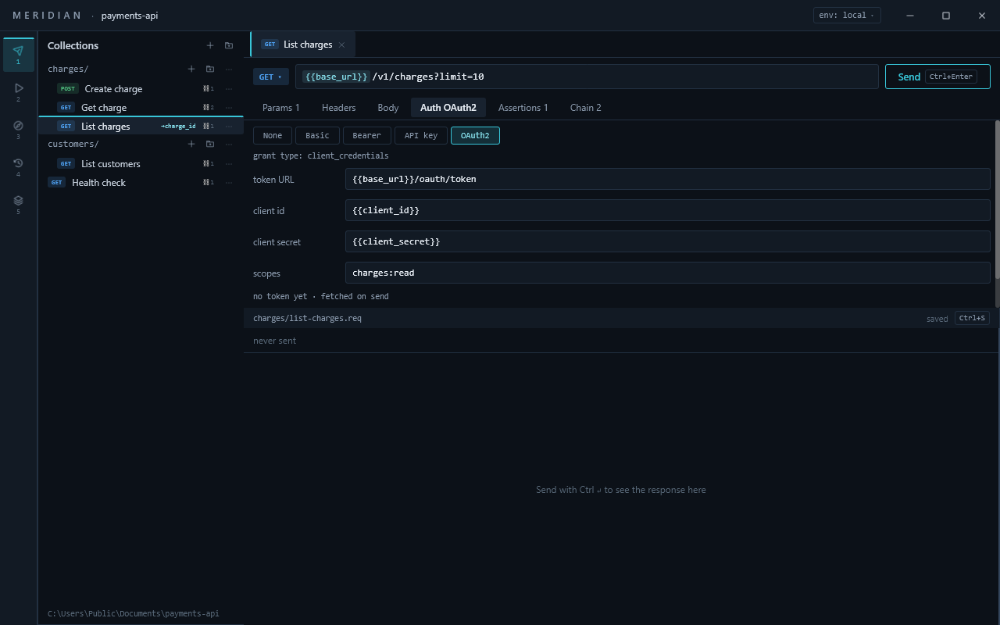
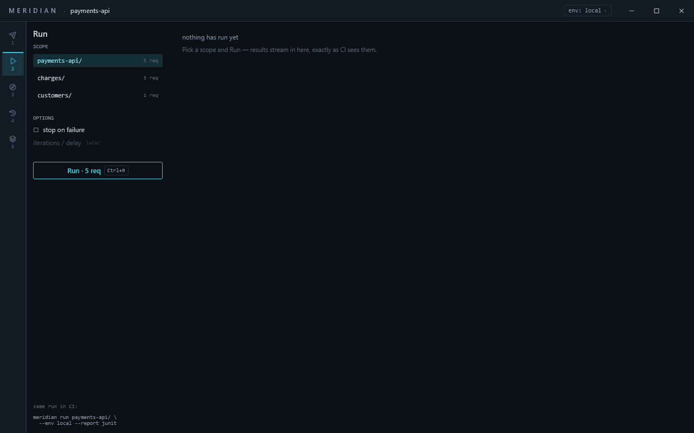
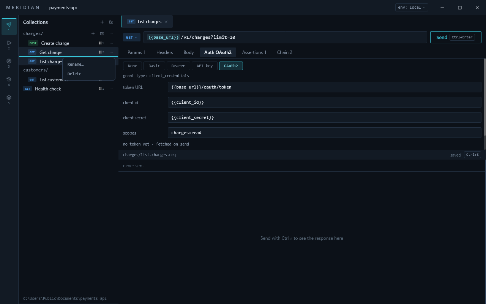

# Using Meridian

Meridian keeps a collection as plain text files in a folder, so you can review a request
in a pull request and run the same files in CI. You never have to write or edit those
files yourself: everything below happens in the app. The files are described in the
[README](README.md), which is also the reference for every key and rule.

**The five views** are on the number keys: **1** Requests, **2** Runner, **3** Discovery,
**4** History, **5** Environments. **Ctrl+P** opens the command palette, which lists every
command and every request by name.

- [Start a collection](#start-a-collection)
- [Make requests and folders](#make-requests-and-folders)
- [Edit and send a request](#edit-and-send-a-request)
- [Set up environments](#set-up-environments)
- [Keep a secret out of the files](#keep-a-secret-out-of-the-files)
- [Walkthrough: OAuth2 client credentials](#walkthrough-oauth2-client-credentials)
- [Check responses and chain requests](#check-responses-and-chain-requests)
- [Run the collection](#run-the-collection)
- [Find an earlier response](#find-an-earlier-response)
- [Rename and delete](#rename-and-delete)

## Start a collection

1. Press **Ctrl+N**, or choose **New collection** on the start screen.
2. Pick the folder to put the collection in.
3. Type a name, for example `payments-api`, and press **Enter**.
4. Type your API's base URL, or leave it blank to fill in later. Press **Enter**.

> **Addresses in this guide are placeholders.** `api.example.com` and its kin are
> reserved for documentation and answer nothing, so a send to them says **could not
> resolve host**. Use your own API's address. To try Meridian without one, use
> `https://httpbin.org`, a public test service: `{{base_url}}/get` returns what you
> sent, and `{{base_url}}/status/404` returns that status. You can change the base URL
> at any time on the Environments view (**5**).

Meridian creates the folder with a first request (`GET {{base_url}}/`) and a `local`
environment holding `base_url`, then opens both. Nothing is written until the last
**Enter**, so **Esc** at any step leaves the disk as it was.

Other ways in:

- **Ctrl+O** opens an existing collection, or any folder of `.req` files.
- **Ctrl+I** imports an OpenAPI spec as a browsable map of endpoints.
- **3** (Discovery) takes a base URL, looks for a spec, and maps what it finds. Its
  **Promote … to collection** writes the endpoints you pick as requests.

## Make requests and folders

On the Requests view (**1**):

- **＋** beside **Collections** makes a request in the collection's root, and the
  **folder ＋** beside it makes a folder.
- Each folder's row has the same pair, for a request or a folder inside it.
- The palette's **New request…** and **New folder…** make them in the root.

Type a name and press **Enter**. A new request starts as `GET {{base_url}}/` and opens
with the keyboard in its URL box. A name with `/`, `\`, `..`, a leading or trailing dot,
a character Windows refuses, or a name already taken is refused in the prompt, with the
reason under the field.

## Edit and send a request

- **The method**: click the method chip (`GET`) and pick another.
- **The URL**: type it, using variables such as `{{base_url}}`. A variable the active
  environment doesn't define is marked unresolved.
- **Params**, **Headers** and **Body** are the tabs under the URL. **＋ add param** and
  **＋ add header** add a row; the body is a text area, JSON by default.
- **Ctrl+Enter** sends and **Esc** cancels. **Ctrl+F** finds text in the response, and
  **Ctrl+\\** moves the response pane between the right and the bottom.
- **Ctrl+S** saves, and **Ctrl+W** closes the tab. If the file changes on disk while you
  have unsaved edits, a bar offers **reload** or **keep mine**.

## Set up environments

An environment holds the variables for one place your API runs: `local`, `staging`, `ci`.
They are edited side by side on the Environments view (**5**): one row per key, one
column per environment.

1. **New environment…** (shown when there are none, or **＋ new environment** under
   the list) asks for a name. The new environment becomes the active one.
2. **＋ add key** adds a key, such as `base_url` or `client_id`, to the active
   environment. Type its value in that environment's column.
3. A key another environment lacks shows **! missing — add to staging** in that
   column: click it, then type the value.
4. **✕** at a row's end removes the key from every environment.
5. Press **Ctrl+S**. The footer counts unsaved environments until you do.

**Switch environment** with **Ctrl+E** or the `env:` chip in the title bar. Choosing
**no environment** is allowed: requests that need a variable then say which one is
missing instead of sending.

## Keep a secret out of the files

A secret, such as a client secret or an API token, is flagged in the environment file,
and its value is kept in this computer's keyring: the Windows Credential Manager, the
macOS login keychain, or the Linux Secret Service (GNOME Keyring, KWallet, KeePassXC).
The value never reaches the collection, so it never reaches the repository.

1. In the **SECRET** column, click **○** next to the key. It turns to **●**, and every
   environment that has the key marks it secret.
2. Press **Ctrl+S** to save the flag.
3. Each environment's cell now says **! not set on this machine — set value**. Click it,
   paste the value and press **Enter**. It goes straight to the keyring.

Once stored, the cell shows the value masked, where it comes from, and
**reveal (5 s)**. Its **⋯** menu (or a right-click on the cell) manages it:

- **Change…** replaces the value. The old one is never shown.
- **Use everywhere** makes this environment's value the *shared* one, which every
  environment without its own uses. If others have their own values, it asks first and
  names them.
- **Set own value…** gives one environment a value of its own, which wins over the
  shared one: a different `client_secret` for `staging`, say.
- **Forget** drops the value from this computer, after asking.

If you typed a value into the table *before* marking the key secret, the cell says
**! still in local.env — move to keyring**. Click it, then **Ctrl+S**, and the file no
longer holds the value.

Turning **●** back off asks what to do with a stored value: **Move into local.env**
(it is then plain text in the file) or **Forget value**.

The first time you store a secret on Linux, your desktop may ask you to choose a
password for a new keyring; on macOS, a newer Meridian may ask once to read a value an
older one stored. Both are your system's own prompts. A computer with no keyring at all
(a server, or a container) tells you so, and names the environment variable to set
instead.

## Walkthrough: OAuth2 client credentials

This sets up a collection that fetches a token with the client-credentials grant and
sends it with every request, without any hand-written files. It needs a real API with
an OAuth2 token endpoint and a client registered on it; the test service above has none.

1. **Make the collection.** Press **Ctrl+N**, pick a folder, name it `payments-api`, and
   give your API's base URL.
2. **Add the client's id.** Press **5**. `local` is active. Click **＋ add key**, type
   `client_id`, press **Enter**, and type the id in the `local` column.
3. **Add the client's secret as a secret.** Click **＋ add key**, type `client_secret`
   and press **Enter**. Click **○** in its **SECRET** column so it turns to **●**, then
   press **Ctrl+S**.
4. **Store the secret's value.** Click **! not set on this machine — set value**, paste
   the secret and press **Enter**.
5. **Set the request's auth.** Press **1**, open **First request** (or make a new
   request), and click the **Auth** tab. Choose **OAuth2**. The fields start as
   `{{base_url}}/oauth/token`, `{{client_id}}` and `{{client_secret}}`. Change the token
   URL if your server's differs, add **scopes** if it needs them, and press **Ctrl+S**.

   
6. **Send.** Press **Ctrl+Enter**. Meridian fetches a token, then sends the request with
   `Authorization: Bearer …`. The Auth tab shows the token's state, such as
   **● token valid · expires in 59 m**, and a later send fetches a new token when it
   expires. If a value is missing, the send stops and says which, such as
   **secret client_secret not set on this machine for local — set it in
   Environments (5)**.
7. **Add staging.** Press **5**, click **＋ new environment**, and type `staging`. Click
   each **! missing — add to staging**, and type staging's `base_url` and `client_id`.
   The `client_secret` row's fix adds it as a secret, and the cell then asks for
   staging's own value: click **set value** and paste staging's secret. Press
   **Ctrl+S**, then **Ctrl+E** to switch between `local` and `staging`.

In CI, the same collection runs with the secret from an environment variable; see
[Run the collection](#run-the-collection).

## Check responses and chain requests

- **Assertions** tab: **＋ assert status 200** and **＋ assert time under 500 ms**
  start you off; **＋ add assertion** adds any other, such as
  `body $.status equals "succeeded"`. Each shows pass or fail after a send.
- **Chain** tab: **＋ add extraction** saves part of a response as a variable, for
  example `body $.id -> charge_id`. A later request uses it as `{{charge_id}}`.

## Run the collection

Press **2**. Pick the scope (the whole collection or one folder), tick **stop on
failure** if you want the run to stop at the first failed assertion, and click **Run**.
**Ctrl+R** runs the collection from any view. Results stream in as they arrive;
afterwards **Re-run failures only**, **Re-run all** and **export report** are on the bar.

The panel shows the same run as a `meridian run` command for CI. There, a secret comes
from an environment variable named after the key (`client_secret`), or after the
environment and the key (`staging__client_secret`) when one job runs several
environments. The README's [Running in CI](README.md#running-in-ci) has a GitHub Actions
example and the exit codes.

## Find an earlier response

The History view (**4**) lists every response you've received. **↑** and **↓** walk the
rows, **Enter** opens one, and **r** (or **Restore to editor**) puts the request back
into the editor as it was sent. Search and the method filters narrow the list.

## Rename and delete

Every row in the Requests tree and in the environment list has a **⋯** at its end, and a
right-click on the row opens the same menu: **Rename…** and **Delete…**. **F2** and
**Delete** do the same for the open request, or for the active environment on the
Environments view.

- **Rename** keeps an open tab, with its unsaved edits, on the renamed file. A renamed
  environment keeps its keyring values and stays active.
- **Delete** asks first and says what goes. Files go to the Recycle Bin on Windows and
  the Trash on Linux, so you can restore them. Where there is no bin, the question says
  the delete is permanent.
